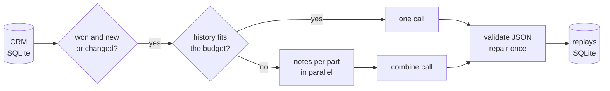

# ClaimReplay

**Learns how each B2B deal was won, so the next one can be won the same way.**

Sales teams keep years of call notes, emails and meeting summaries in their CRM, and almost nobody
reads them once a deal closes. ClaimReplay reads the full history of every won deal with an LLM and
writes a short, structured *replay*:

```json
{
  "summary": "Bracken Freight bought to stop bad data reaching their executive dashboards...",
  "turning_point": "The proof of concept found 11 issues their checks had missed, in front of the CFO.",
  "winning_moves": ["Ran a two-week proof of concept on their noisiest pipeline", "..."],
  "objections": [{"objection": "Corvane quoted 20% less", "response": "Rebuilt the business case around ...",
                  "outcome": "resolved"}],
  "stakeholders": [{"name": "Priya Okafor", "title": "Head of Data", "role_in_deal": "champion"}],
  "competitor_notes": "Won on time to value, not price."
}
```

It is the first of four tools I built around one question: *what does a rep need to win the next
call?*

| Tool | Job |
|---|---|
| **ClaimReplay** (this repo) | Learns how each won deal was won |
| **ClaimScout** | Finds patterns across replays, per competitor and industry |
| **ClaimPrep** | Pre-call brief for an open deal: questions to ask, objections to expect |
| **ClaimCoach** | Chat assistant that coaches a rep through a deal, including objection role-play |

## How it works



| Module | Responsibility |
|---|---|
| `crm.py` | Read-only CRM access; a `DealRecord` with its activities in date order and a content fingerprint |
| `replayer.py` | One deal → one replay: single call, or map-reduce over parts for long histories |
| `structured.py` | JSON in, validated pydantic model out, with one repair round-trip on failure |
| `budget.py` | Token estimates, middle-clipping, and packing activities into parts |
| `pipeline.py` | Finds deals to (re)do, runs them concurrently, saves each as it finishes |
| `store.py` | Replay table, with the attributes downstream tools group by |
| `llm.py` | Minimal async client for any OpenAI-compatible endpoint |
| `demo.py` | A deterministic, fully invented CRM for demos and tests |

### Design choices

- **Redo only what changed.** Each replay stores a fingerprint of the deal it was written from (a hash
  of the deal, its activities and qualification notes). A run redoes a deal only when the fingerprint
  changed, so it is cheap to run nightly and safe to re-run after a crash.
- **Validated output, not hopeful parsing.** Replies are checked against pydantic models. Code fences
  and `<think>` blocks are stripped. If validation still fails, the exact error goes back to the model
  once. Over-long lists are trimmed rather than rejected.
- **Long histories are read, not truncated.** When a deal's history won't fit, activities are packed
  into parts (never split mid-activity), each part is summarized in parallel, and a final call writes
  the replay from the notes. Only a single activity bigger than a whole part is clipped, keeping its
  start and end with a visible marker.
- **Provider-neutral.** Works against OpenAI, Ollama, vLLM or LM Studio. Token counts are a
  conservative character-based estimate, so no tokenizer download is needed, and the budget keeps
  10% headroom.
- **Fail one, not all.** A deal that errors is logged by id and error type only (deal text can contain
  customer details) and retried next run. Every finished replay is saved right away.
- **Prompts are versioned.** `PROMPT_VERSION` is stored with each replay, so replays written by an
  older prompt can be found and redone.

## Try it

```bash
python -m venv .venv && source .venv/bin/activate
pip install -e ".[dev]"
cp .env.example .env                 # defaults to a local Ollama model

claim-replay demo-data                # 40 invented deals -> data/crm.sqlite3
claim-replay run --limit 5            # replay the 5 most recent wins
claim-replay show 3                   # print one replay
claim-replay run                      # the rest; already-done deals are skipped
```

The CRM schema is in [src/claim_replay/crm_schema.sql](src/claim_replay/crm_schema.sql). To use a real
CRM, export to that schema or adapt `crm.py`; nothing else reads the CRM.

## Development

```bash
pytest       # scripted fake model, generated CRM: no network or API key
ruff check .
```

All company names, people and deals in the demo data are invented.

**Author:** Vihas Adi
